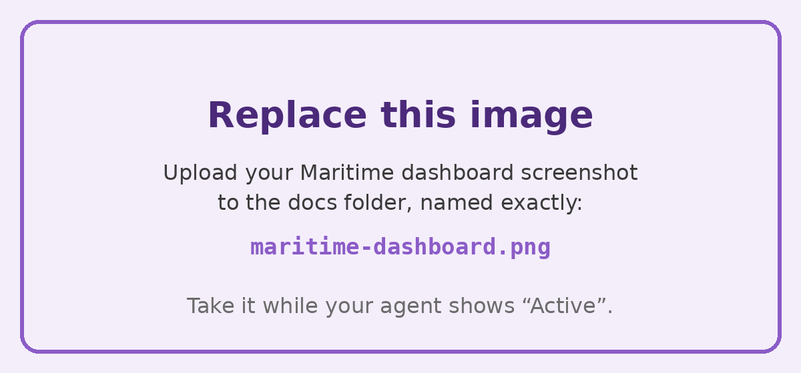

# WhisperGuard

We built **WhisperGuard** so that **a woman who feels unsafe** can **get a fake call, an incident record and help from people she trusts, just by saying an ordinary sentence to her phone.**

| | |
|---|---|
| Track | Women's Safety |
| Team | Shalini Ananda (solo builder: product, design and engineering) |
| Technical builder | Shalini Ananda |
| Demo video (60 to 90 s) | ✏️ link |
| Pitch deck (up to 5 slides) | ✏️ link, or upload it to `docs/` |
| Live app (optional) | https://shalinianandaphd.github.io/WhisperGuard/ |

Built at BUILD FOR HER · SF Tech Week · San Francisco · October 10, 2026

## 1. The problem

🏅 Judged under: Impact on women (30 pts)

Stalking is common, and most of it still happens in person. More than 1 in 5 US women (22.5%, about 28.8 million) have been stalked in their lifetime, and 78% of them were followed, watched or spied on in person. In that moment, visibly opening an SOS app or calling for help can draw the attention of the person following her. It is no surprise that only 58% of US women feel safe walking alone at night, compared with 84% of men.

Sources:

* The National Intimate Partner and Sexual Violence Survey: 2023/2024 Stalking Data Brief, Centers for Disease Control and Prevention, 2025
* Global Safety Report, Gallup, 2025

## 2. Who it's for

🏅 Judged under: User insight & responsible design (25 pts)

**Our user:** A woman who senses she is being followed or watched, whether she is walking home, on transit, in a rideshare or on a first date, and who cannot safely look like she is asking for help.

**What we learned from our subject matter expert:**

**The expert.** Eva Galperin is Director of Cybersecurity at the Electronic Frontier Foundation. She works with survivors of tech enabled abuse. We learned from her public TEDWomen 2019 talk, [What you need to know about stalkerware](https://www.ted.com/talks/eva_galperin_what_you_need_to_know_about_stalkerware). We did not interview her directly.

**The insight that changed what we built.** Galperin explains that survivors are often unsure whether to cut off an abuser's access. Tipping the abuser off can lead to escalation, or even greater violence. That is why the antivirus tools she worked with flag stalkerware but do not remove it automatically: the survivor decides when to act.

**What we built because of it.** WhisperGuard never does anything visible that could tip off the person watching.

* There is no SOS screen.
* The trigger is an ordinary sentence.
* Every alert waits behind a cancel window, so she stays in control of what happens and when.

## 3. What it does

**The user** chats with Nimbus, an assistant that looks completely ordinary. When she feels unsafe, she says a code phrase inside a normal sentence, such as "Can you remind me to buy blueberries?"

**Then** WhisperGuard quietly starts a safety workflow while the screen shows only an ordinary reply.

* A fake incoming call rings a few seconds later.
* An incident note starts logging what happens, with timestamps.
* An emergency message with her location is queued for her trusted contacts, behind a short cancel window.

**Finally,** when she is safe she says "I found my keys." That cancels anything still pending, tells her contacts she is okay, and closes the incident note.

| Code phrase | What happens |
|---|---|
| "Did I leave the oven on?" | Escape call: fake call and incident note |
| "Remind me to buy blueberries" | Full alert: fake call, incident note and emergency message |
| "I found my keys" | All clear: everything stands down |

Phrases are matched by their key words, so natural variations like "I think I left the oven on" still work. Users can change all three phrases in Settings.

When a phrase is recognized, Nimbus starts its reply with "Got it" instead of its usual "Sure." She knows it worked without anything visible changing on screen.

## 4. How it uses Maritime

🏅 Judged under: Execution & use of Maritime (25 pts)

| | |
|---|---|
| Agent / instance name | ✏️ |
| How we set it up | ✏️ e.g. OpenClaw template from the dashboard |
| Its role, in one sentence | ✏️ |

**Screenshot of our Maritime dashboard**

✏️ Upload your screenshot to `docs/maritime-dashboard.png`



## 5. What's real, what's mocked

**Works end to end:**

* Code phrase recognition from typed input, or from spoken input in Chrome
* The disguised assistant replies
* The fake call screen, with a ringtone and caller voice
* The cancel window countdown
* The timestamped incident note
* The all clear flow
* Onlooker view
* Settings, saved in the browser

**Mocked or hard coded:**

* No audio is recorded, no phone call is placed and no message is sent.
* The location is fictional and the contacts are example names.
* The fake caller's lines are scripted.
* Nimbus's everyday replies are canned.

## 6. How to run it

The easiest way is to open the live app: https://shalinianandaphd.github.io/WhisperGuard/

To run it locally:

```bash
git clone https://github.com/ShaliniAnandaPhD/WhisperGuard.git
cd WhisperGuard
python3 -m http.server 3000
```

Then open http://localhost:3000 in Chrome. You can also open `index.html` directly.

**Environment variables needed:** None.

## 7. Built with

**AI models:** None at runtime. Code phrase matching is a lightweight key word matcher that runs entirely in the browser. That way the trigger never waits on a network request.

**AI coding assistants:** Claude

**Libraries & APIs:**

* Plain HTML, CSS and JavaScript, with no framework
* The browser's Web Speech API, for voice input and the fake caller's voice
* The Web Audio API, for the ringtone
* Google Fonts (Bricolage Grotesque and Atkinson Hyperlegible)
* GitHub Pages, for hosting

**No code tools:** Claude, for the pitch deck

## 8. Data

| Data source | Public or synthetic? | Link |
|---|---|---|
| CDC NISVS 2023/2024 Stalking Data Brief | Public | https://www.cdc.gov/nisvs/media/pdfs/stalking-brief.pdf |
| Gallup 2025 Global Safety Report | Public | https://news.gallup.com/poll/695240/people-feel-safe-even-global-conflicts-rise.aspx |
| Eva Galperin, "What you need to know about stalkerware," TEDWomen 2019 | Public | https://www.ted.com/talks/eva_galperin_what_you_need_to_know_about_stalkerware |
| Demo names, contacts, location and caller script | Synthetic | Written for this demo, in `index.html` |

## 9. Pre-existing work

None. All code was written during BUILD FOR HER on October 10, 2026.

## 10. Responsibility note

🏅 Judged under: User insight & responsible design (25 pts)

**Women's Safety · How could an abuser or bad actor misuse this, and what did we do about it?**

**An abuser who monitors her phone could discover it.**

* The disguise protects against someone glancing at her screen. It does not protect against stalkerware: the CDC found that 1 in 5 female stalking victims (20.1%) had their communication or activities monitored through software or apps without permission. We state this limit openly rather than overpromise.
* What we did: there is no SOS screen and no visible alert state, and the code phrases are chosen by the user.

**Someone could set it up on another person's phone to track her.**

* Location is shared only during an alert the phone's owner triggers herself, and only with contacts she chooses.
* Sharing stops at the all clear. Nothing tracks her in the background.

**False alarms or hoaxes could erode trust in real alerts.**

* Every emergency message waits behind a cancel window.
* Saying the all clear phrase stops it before anyone is contacted.

**A code phrase could become known.**

* All three phrases can be changed at any time in Settings.

WhisperGuard supports emergency services and never replaces 911. In this demo, nothing leaves the device.

## 11. What we'd build next

* Silent tap triggers, for when speaking is not safe
* Code phrases in any language
* A check in timer that escalates if no all clear arrives
* Real message delivery through an SMS provider, with consent from each trusted contact
* A pilot with a domestic violence advocacy organization, so survivors and advocates shape it before any real alerts are sent

## Team & ownership

WhisperGuard is a solo project. Shalini Ananda built it and owns it.
